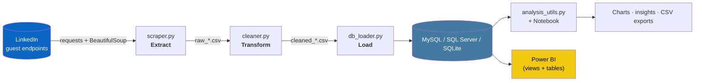
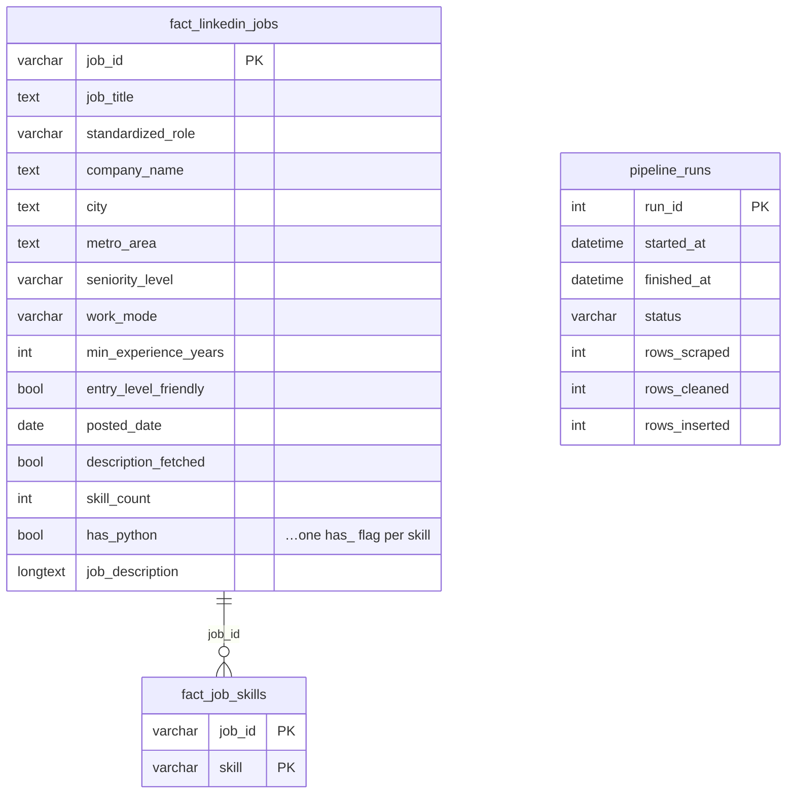

<div align="center">

# 📊 LinkedIn Job Market Analytics

### An end-to-end ETL pipeline and analysis notebook that turns public job postings into skill-demand insights for Data & Business Analyst roles

<br>


**Scrape → Clean → Warehouse → Analyse → Visualise**

[Quick Start](#-quick-start) · [Architecture](#-architecture) · [Data Model](#-data-model) · [Notebook](#-the-notebook) · [Configuration](#-configuration) · [FAQ](#-troubleshooting)

</div>

---

## 🎯 What this project answers

Job seekers are told to "learn SQL, Excel, Python and Power BI", but **how much of the real market does that actually cover?** This project collects live postings and answers questions such as:

| Question | Where you get the answer |
|---|---|
| Which skills do Data / Business Analyst postings ask for most? | Skill demand chart |
| How does demand differ between Data Analyst, BI Developer and Business Analyst roles? | Role × skill heatmap |
| Which skills are usually asked **together**? | Co-occurrence matrix |
| How much experience do employers ask for, and how many roles welcome freshers? | Experience and entry-level analysis |
| **What % of postings can I already apply to, and which one skill should I learn next?** | Skill-match score |
| Who is hiring, where, and in what work mode (remote / hybrid / on-site)? | Overview charts |

---

## ✨ Features

- **🔌 Modular ETL**: separate scraper, cleaner and loader modules, orchestrated by a CLI *or* a notebook
- **🛡️ Never invents data**: missing dates stay `NULL`, missing categories become `Not Specified`, and postings whose description failed to download are flagged and excluded from skill statistics
- **♻️ Safe to re-run**: jobs already stored are skipped *before* their detail page is requested, which saves requests and reduces blocking
- **🧠 17 skill detectors**: word-bounded regexes (Python, R, SQL, Power BI, Tableau, Looker, Excel, Google Sheets, SAS, ETL, Airflow/dbt, Big Data, Cloud, Git, Statistics, Machine Learning, Data Viz)
- **🔎 Rich feature extraction**: minimum experience, work mode, entry-level friendliness, role family, city and metro area
- **🗄️ Three databases supported**: MySQL (default), SQL Server, or zero-setup SQLite
- **📐 Power BI ready**: star-schema style tables, three ready-made views, and CSV exports
- **🚦 Polite scraper**: sessions, retries, backoff, and automatic slow-down after HTTP 429
- **🧾 Audit trail**: every run is logged to a `pipeline_runs` table
- **🧪 Tested**: unit tests cover the regexes, cleaning rules and scraper logic (offline, with fake HTTP)
- **🎭 Demo mode**: no data yet? The notebook falls back to clearly-labelled **synthetic** data so every chart still renders

---

## 🏗️ Architecture



### Project structure

```text
linkedin-job-etl/
├── linkedin_job_etl_pipeline.ipynb   ← step-by-step pipeline + analysis
├── main.py                           ← same pipeline from the command line
├── config.py                         ← keywords, filters, skill regexes, DB settings
├── scraper.py                        ← Extract
├── cleaner.py                        ← Transform
├── db_loader.py                      ← Load (schema, views, run log)
├── analysis_utils.py                 ← data access + skill analytics
├── demo_data.py                      ← synthetic data for testing / demos
├── tests/test_pipeline.py            ← unit tests
├── requirements.txt
├── .env.example                      ← copy to .env and add your DB password
├── data_backups/                     ← raw_*.csv and cleaned_*.csv (auto-created)
└── powerbi_exports/                  ← CSVs for Power BI (auto-created)
```

---

## 🚀 Quick Start

### 1. Install

```bash
git clone https://github.com/jaynilmistry184-sys/linkedin-job-etl.git
cd linkedin-job-etl
pip install -r requirements.txt
```

### 2. Configure your database

```bash
cp .env.example .env        # Windows: copy .env.example .env
```

Edit `.env`:

```ini
DB_BACKEND=mysql            # mysql | sqlserver | sqlite
DB_HOST=localhost
DB_PORT=3306
DB_USER=root
DB_PASSWORD=your_password
DB_NAME=JobMarketAnalytics
```

> 💡 **No database?** Set `DB_BACKEND=sqlite` and everything works with a local file.

### 3. Run it

**Option A: the notebook (recommended)**

```bash
jupyter notebook linkedin_job_etl_pipeline.ipynb
```

**Option B: the command line**

```bash
python main.py --pages 1                                    # small test run
python main.py --keywords "Data Analyst" "SQL Developer"    # custom keywords
python main.py --locations Mumbai Pune --date-posted 24h    # several cities
python main.py --from-raw data_backups/raw_<timestamp>.csv  # re-clean without scraping
python main.py --no-db                                      # CSV output only
```

> ⚠️ **Start small.** LinkedIn rate-limits quickly. 1 page ≈ 10 jobs per keyword; increase gradually.

---

## 🗃️ Data model



| Object | Type | Purpose |
|---|---|---|
| `fact_linkedin_jobs` | Table | One row per job posting, with skill flags and derived features |
| `fact_job_skills` | Table | One row per job × skill, the best shape for Power BI skill visuals |
| `pipeline_runs` | Table | Audit log: status, row counts and error message for each run |
| `vw_skill_demand_summary` | View | Skill counts and % per role (only postings with a description) |
| `vw_unpivoted_skills` | View | Skills joined to role, company, city and date |
| `vw_company_hiring_velocity` | View | Openings per company, role and city |

> 🔁 An **existing** `fact_linkedin_jobs` table is upgraded in place: missing columns are added and old rows are back-filled.

---

## 📓 The notebook

`linkedin_job_etl_pipeline.ipynb` connects every module in one flow.

| # | Section | What it does |
|---|---|---|
| 1–3 | Setup | Verifies files, reloads modules, shows run settings |
| 4 | Database | Connects, creates or upgrades tables, loads existing IDs; continues without a DB if the connection fails |
| 5 | **Extract** | Scrapes new postings and saves a raw CSV |
| 6 | **Transform** | Cleans, extracts features, saves a cleaned CSV and shows a quality audit |
| 7 | **Load** | Inserts new jobs and skills in one transaction, refreshes views, logs the run |
| 8 | Verify | Queries the views back from the database |
| 9 | Load analysis data | Database → latest CSV → demo data (first available) |
| 10–15 | **Analysis** | Overview · skill demand · role heatmap · co-occurrence · experience & entry-level · **skill-match score** · work mode · location · trend |
| 16 | Export | CSVs for Power BI in `powerbi_exports/` |
| 17 | Findings | Auto-generated summary of the key results |

### The skill-match score

Set your own skills once:

```python
MY_SKILLS = ["Excel", "SQL", "Python", "Power_BI", "Data_Viz"]
```

The notebook then reports:

- the % of postings that ask for **at least one** of your skills
- the % that ask **only** for skills you already have
- which **single** extra skill would unlock the most additional postings

---

## ⚙️ Configuration

Everything lives in `config.py`.

| Setting | Default | Description |
|---|---|---|
| `SEARCH_KEYWORDS` | 9 analyst titles | Job titles to search |
| `SEARCH_LOCATIONS` | `["Mumbai"]` | Add `"Pune"`, `"Bengaluru"`, … to compare cities |
| `PAGES_PER_KEYWORD` | `2` | ~10 postings per page |
| `DATE_POSTED` | `"week"` | `"24h"`, `"week"`, `"month"` or `None` |
| `EXPERIENCE_LEVELS` | `None` | e.g. `[1, 2]` for internship + entry level (verify the codes in your browser's network tab) |
| `SORT_BY` | `"recent"` | `"recent"` or `"relevant"` |
| `DETAIL_DELAY` / `PAGE_DELAY` | `(1.2, 2.8)` / `(2.5, 5.0)` | Random delay ranges, in seconds |

### ➕ Add a new skill in one line

```python
SKILL_PATTERNS = {
    ...
    "Looker": r"\blooker\b|\blooker\s*studio\b",
}
```

The database column, the long skills table, the views and the notebook charts all pick it up automatically. Use word boundaries (`\b`) and non-capturing groups `(?:…)`.

---

## 🧹 What the cleaner does

| Step | Detail |
|---|---|
| Deduplicate | By `job_id`, and by title + company + city (reposts under new IDs) |
| Standardise roles | `Data Analyst`, `Business Analyst`, `BI Developer`, `Data Scientist`, `Data / Analytics Engineer` |
| Parse location | City, state and country, with aliases (Bangalore → Bengaluru) and a `metro_area` grouping |
| Flag skills | One boolean per skill, plus a readable `extracted_skills` string |
| Extract experience | Minimum years asked, from text near the word "experience" |
| Detect work mode | Hybrid / Remote / On-site / Not Specified |
| Entry-level flag | "Fresher", "entry level" or "trainee" in the text, ≤ 1 year asked, or Entry/Internship seniority |
| Protect statistics | `description_fetched` marks postings whose description was actually downloaded |

---

## 🧪 Tests

```bash
pytest -q
```

Tests cover role classification (including the classic `"Mumbai"` contains `"ai"` bug), location parsing, skill regexes, experience extraction, repost removal, and the scraper's pagination, filters and duplicate skipping, all offline using fake HTTP responses.

---

## 🛠️ Troubleshooting

<details>
<summary><b>Access denied for user 'root'@'localhost' (using password: NO)</b></summary>

The password did not reach the code. Check that `python-dotenv` is installed, that the file is named exactly `.env` (not `.env.txt`) and sits next to `config.py`, and that special characters in the password are quoted: `DB_PASSWORD="my#pass"`.
</details>

<details>
<summary><b>Many "Rate limited (429)" warnings</b></summary>

Normal for LinkedIn's guest endpoints. The scraper slows itself down and retries once after a cool-down. Use fewer keywords or pages, or wait a few minutes. Re-runs skip jobs you already stored.
</details>

<details>
<summary><b>"No job cards found"</b></summary>

Either the results ended, LinkedIn blocked the request, or its HTML changed. Try again later or from a different network.
</details>

<details>
<summary><b>Some postings show "Description Unavailable"</b></summary>

Their detail page failed to download (usually a 429). They are kept but excluded from skill percentages.
</details>

<details>
<summary><b>Wrong or missing driver</b></summary>

MySQL needs `mysql-connector-python` (or set `MYSQL_DRIVER=pymysql` and install `pymysql`). SQL Server needs `pyodbc` and an ODBC driver.
</details>

---

## ⚖️ Responsible use

- LinkedIn's terms of service prohibit automated scraping, and the guest endpoints can rate-limit or block your IP. This project is for **personal learning and portfolio work**.
- Keep request volumes small and keep the built-in delays.
- **Do not publish scraped data.** Commit the code and the synthetic demo data only; `data_backups/`, `powerbi_exports/` and `.env` are already in `.gitignore`.
- Experience, work mode and entry-level fields come from regexes on free text. They are good estimates, not facts, so spot-check them.

---

## 🗺️ Roadmap

- [ ] Power BI dashboard on the MySQL views (skill demand, hiring map, skill-match page)
- [ ] Scheduled runs (Windows Task Scheduler / cron)
- [ ] Salary extraction where postings state it
- [ ] Cross-run repost detection (title + company across runs)
- [ ] Multi-city comparison report

---

## 👤 Author

**Jaynil Mistry**: aspiring Data / Business Analyst based in Mumbai
Skills: Advanced Excel · SQL · Python · Power BI

GitHub: [@jaynilmistry184-sys](https://github.com/jaynilmistry184-sys)

---

<div align="center">

If this project helped you, consider giving it a ⭐

</div>
